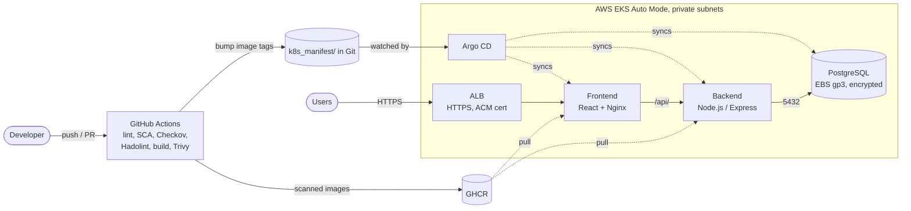

# Blog Platform: DevSecOps on AWS EKS

[](https://github.com/muhammad-31/devsecops-eks-blog-platform/actions/workflows/cicd.yaml)


A full-stack blog application (React, Node.js, PostgreSQL) delivered to AWS EKS
Auto Mode through a DevSecOps pipeline: every change is linted, its
dependencies audited, its infrastructure scanned and its container images
scanned **before** they are published. Argo CD then deploys whatever the
manifests in Git say.

## Architecture



## Tech stack

| Layer | Tools |
|---|---|
| Infrastructure | AWS EKS Auto Mode, VPC (3 AZs), EBS gp3, ALB, KMS, provisioned with Terraform |
| CI | GitHub Actions: ESLint, npm audit, Checkov, Hadolint, Docker Buildx, Trivy |
| CD | Argo CD (GitOps, [`argocd/application.yaml`](argocd/application.yaml)), image tags bumped by the pipeline |
| Application | React + Vite served by Nginx, Node.js/Express API, PostgreSQL |
| Ingress | AWS Load Balancer (EKS Auto Mode), HTTPS with an ACM certificate; the domain's DNS record points at the ALB |

## CI/CD pipeline

Defined in [`.github/workflows/cicd.yaml`](.github/workflows/cicd.yaml).
Pull requests run every check; pushes to `main` also publish and deploy.

| Stage | Tool | Blocks the release when |
|---|---|---|
| 1. Lint | ESLint | there are lint errors |
| 2. Dependency audit | npm audit | a runtime dependency has a high or critical advisory |
| 3. IaC | `terraform fmt`/`validate`, Checkov | Terraform is malformed or misconfigured, including resources created by the registry VPC/EKS modules (Kubernetes manifests: report only, see below) |
| 4. Dockerfile lint | Hadolint | a Dockerfile breaks best practices |
| 5. Smoke test | Docker Compose | the local stack does not start, or a post cannot be created through Nginx |
| 6. Build | Docker Buildx | the image does not build |
| 7. Image scan | Trivy | the image has a fixable CRITICAL or HIGH CVE (nothing is pushed in that case) |
| 8. Deploy | git commit | (runs only after 1-7 pass) new image tags are written to `k8s_manifest/`; Argo CD syncs them |

**Supply-chain hardening:** every third-party action is pinned to a full commit
SHA. In March 2026 attackers force-pushed most `aquasecurity/trivy-action` tags
to malicious commits; workflows that referenced a tag or `@master` ran that code.
The scan here is pinned to the release Aqua confirmed as unaffected.

## Infrastructure

Terraform with the official AWS VPC and EKS modules:

- **EKS Auto Mode** with the `general-purpose` and `system` node pools, so there are no node groups to manage.
- **VPC** with three public and three private subnets across three AZs and a single NAT gateway.
- **Secrets encryption** with KMS, and all control-plane log types sent to CloudWatch.
- **Kubernetes 1.36**, in standard support until August 2027. An existing cluster
  on an older version has to be upgraded one minor version at a time.
- **Public API endpoint** for kubectl and CI, restricted by
  `cluster_endpoint_public_access_cidrs` (open by default, set it to your own ranges).
- **EBS gp3** encrypted volume for PostgreSQL (`Retain` reclaim policy).

```bash
cd terraform
terraform init
terraform apply
aws eks update-kubeconfig --name Jerney-eks-cluster --region ap-south-1
```

Destroy it when you are done (`terraform destroy`). An EKS cluster, NAT gateway
and load balancer cost money every hour they run.

## Deploying to Kubernetes

Set your domain and ACM certificate ARN in
[`k8s_manifest/06-ingress/ingress.yaml`](k8s_manifest/06-ingress/ingress.yaml)
(the values there are placeholders).

The database credentials are never stored in Git. Create them first (see
[`docs/db-secret.example.yaml`](docs/db-secret.example.yaml)):

```bash
kubectl apply -f k8s_manifest/00-namespace/
kubectl -n jerney create secret generic jerney-db-secret \
  --from-literal=POSTGRES_USER=jerney_user \
  --from-literal=POSTGRES_PASSWORD="$(openssl rand -base64 24)" \
  --from-literal=POSTGRES_DB=jerney_db
```

Then register the Argo CD Application, which syncs `k8s_manifest/` from `main`:

```bash
kubectl apply -n argocd -f argocd/application.yaml
```

Without Argo CD, apply the manifests in order:

```bash
for dir in 01-storage 03-database 04-backend 05-frontend 06-ingress 07-network; do
  kubectl apply -f "k8s_manifest/$dir/"
done
```

## Security controls

| Control | Where |
|---|---|
| Only the frontend is exposed; it proxies `/api/` to the backend inside the cluster | `06-ingress`, `frontend/nginx.conf` |
| NetworkPolicies: database accepts only the backend, backend accepts only the frontend | `07-network` |
| No privilege escalation and `RuntimeDefault` seccomp on every pod | deployments |
| Backend: non-root, read-only root filesystem, all capabilities dropped | `04-backend` |
| Frontend: non-root (UID 101), Nginx on port 8080, all capabilities dropped | `05-frontend` |
| Images built from current LTS bases (Node 22, Nginx 1.30) and scanned before push | Dockerfiles, pipeline |
| No credentials in the repository: the cluster Secret is created out of band, local development reads an untracked `.env` | `docs/db-secret.example.yaml`, `.env.example`, `.gitignore` |

**Open items** (why the Kubernetes Checkov scan is report-only for now):
PostgreSQL still runs as root (the official image needs it for initialisation),
images are referenced by tag rather than digest, and the frontend root filesystem
is writable. Next steps: run PostgreSQL as a non-root UID with an init container
fixing volume permissions, pin images by digest, and move secrets to the
External Secrets Operator with AWS Secrets Manager.

## Repository structure

```text
├── frontend/              # React (Vite) app + Nginx config
├── backend/               # Node.js Express API
├── terraform/             # VPC + EKS Auto Mode
├── k8s_manifest/          # Kubernetes manifests, applied in numeric order
│   ├── 00-namespace/
│   ├── 01-storage/        # gp3 StorageClass and PVC
│   ├── 03-database/       # PostgreSQL
│   ├── 04-backend/
│   ├── 05-frontend/
│   ├── 06-ingress/        # ALB Ingress (HTTPS, ACM)
│   └── 07-network/        # NetworkPolicies
├── argocd/                # Argo CD Application for k8s_manifest/
├── docs/                  # Secret template
├── deploy/                # Single-EC2 alternative (Nginx, PM2, setup script)
├── docker-compose.yaml    # Local development (credentials from .env)
└── .github/workflows/cicd.yaml
```

## Local development

```bash
cp .env.example .env    # then set POSTGRES_PASSWORD in .env
docker compose up --build
```

Open http://localhost. The frontend's Nginx proxies `/api/` to the backend, the same way it does in the cluster.
